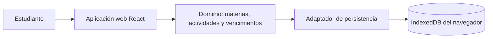

# Plan técnico de StudyFlow

Estado: propuesta técnica alineada con la SPEC; lista para revisión y aprobación final. Las dudas no bloqueantes siguen identificadas en la SPEC. No se crea `tasks.md` hasta recibir aprobación explícita.

## 1. Arquitectura general

StudyFlow será una aplicación web cliente que ejecuta React en el navegador y guarda todas las materias y actividades en IndexedDB. No necesita backend, API, base de datos remota, autenticación ni conexión de red para las operaciones del MVP.



Los datos son locales al perfil y origen del navegador. No se sincronizan ni se comparten entre dispositivos o perfiles, de acuerdo con la SPEC.

## 2. Stack y decisiones técnicas

| Área | Decisión | Justificación | Alternativa descartada |
| --- | --- | --- | --- |
| Interfaz | React + TypeScript + Vite | Aprobado por el usuario. React organiza listas, formularios y estados de interfaz; TypeScript tipa tipos y estados de actividad. Vite sirve para construir el frontend cliente sin una capa de servidor. | Un framework full-stack no aporta una necesidad de servidor y agregaría una capa fuera del alcance. La guía de React recomienda considerar frameworks para apps nuevas; se retiene Vite porque la arquitectura aprobada es local y cliente. |
| Persistencia | IndexedDB nativo del navegador | Cumple la persistencia entre usos sin servidor y ofrece operaciones asíncronas y transaccionales sobre registros estructurados. | `localStorage` es más simple pero síncrono y menos adecuado para transacciones entre materias y actividades. Una biblioteca envolvente se descarta para no añadir dependencias sin necesidad; se usará la API nativa. |
| Backend y API | Ninguno | La SPEC exige datos locales y excluye almacenamiento remoto y sincronización; las operaciones del MVP pueden ejecutarse en el cliente. | Django REST Framework, PostgreSQL y API REST se eliminan porque ya no son necesarios y contradirían la decisión local. |
| Identificadores | UUID generado por el navegador | Permite editar/eliminar una actividad incluso cuando su título se repite. | El título como identificador se descarta porque no es único. |
| Contrato de API | No aplica | No hay servidor ni llamadas de API para operaciones de materias/actividades. | REST y OpenAPI no se incluyen en este MVP. |

No se agregan dependencias de terceros para IndexedDB ni para manipular fechas. La plataforma del navegador proporciona ambas capacidades.

## 3. Estructura de carpetas y módulos

Estructura propuesta para la etapa de implementación; no se crean código ni archivos en esta fase:

```text
studyflow/
└── src/
    ├── app/                     # composición y navegación de pantallas
    ├── features/
    │   ├── subjects/            # registro y consulta de materias
    │   └── activities/          # alta, edición, borrado, lista, filtros y estado
    ├── domain/
    │   ├── subjects/            # reglas y validación de materias
    │   ├── activities/          # reglas y validación de actividades
    │   └── due-dates/           # fecha local y clasificación de vencimientos
    ├── persistence/
    │   ├── database/            # apertura, versión y migraciones de IndexedDB
    │   ├── subjects/            # lecturas y escrituras de materias
    │   └── activities/          # lecturas y escrituras de actividades
    └── shared/                  # componentes comunes y presentación de errores
```

El módulo `features` coordina interacción de usuario; `domain` contiene reglas independientes de la interfaz; `persistence` es el único módulo que accede a IndexedDB. No habrá módulos de cuentas, correo, backend o API.

## 4. Modelo de datos

Base local propuesta: base IndexedDB `studyflow`, con almacenes de objetos separados.

### `subjects`

| Campo | Tipo | Regla |
| --- | --- | --- |
| `id` | UUID, clave primaria | Identificador técnico estable. |
| `name` | cadena | Único dato de negocio; requerido, no vacío ni de solo espacios, máximo 100 caracteres. Se conserva el texto ingresado. |
| `normalizedName` | cadena técnica | Valor derivado de quitar espacios exteriores y convertir a minúsculas; índice único para impedir nombres equivalentes. No se muestra como dato de negocio. |

No se proporcionan operaciones de edición o eliminación de materias. Los espacios interiores y los acentos se conservan y cuentan para la comparación; la equivalencia aprobada ignora mayúsculas/minúsculas y espacios exteriores.

### `activities`

| Campo | Tipo | Regla |
| --- | --- | --- |
| `id` | UUID, clave primaria | Identifica una actividad independientemente de su título. |
| `title` | cadena | Obligatorio, no vacío ni de solo espacios, máximo 100 caracteres; sin índice único. Títulos repetidos permitidos. |
| `type` | enumeración | `tarea`, `trabajo` o `examen`. |
| `subjectId` | UUID | Obligatorio; referencia a una materia existente. |
| `dueDate` | cadena canónica `YYYY-MM-DD` | Obligatoria; fecha calendario, sin hora. |
| `description` | cadena o `null` | Opcional. |
| `status` | enumeración | `pendiente` o `completada`; al crear una actividad se asigna `pendiente`. |

Índices propuestos de IndexedDB: `subjectId`, `status` y `dueDate`; `subjects.normalizedName` tiene índice único. La clasificación de vencimiento no se persiste, porque depende de la fecha local del día de consulta.

## 5. Persistencia local

- Al inicio, la aplicación abre la base IndexedDB local y carga materias y actividades necesarias para la pantalla.
- Cada operación de escritura se realiza en una transacción de IndexedDB. La interfaz confirma el guardado solo después de completar la transacción.
- Al crear o editar una actividad, se valida que `subjectId` exista. La comprobación y escritura se llevan a cabo dentro de la misma transacción que incluye ambos almacenes.
- Las transacciones fallidas se abortan; la aplicación no limpia ni reemplaza la base como estrategia de recuperación. Solo se comunica el éxito después de completar la transacción.
- El acceso a IndexedDB queda encapsulado tras repositorios locales para separar la interfaz y las reglas de dominio del formato de persistencia.
- La base tendrá un número de versión y una función de actualización de esquema para cambios internos compatibles en etapas posteriores. No se necesita una migración inicial de datos remotos.
- No se crea respaldo, exportación, importación ni recuperación remota. Si se elimina el almacenamiento del sitio, la SPEC no garantiza recuperar los datos.

## 6. Validaciones, estados, filtros, orden y vencimientos

### Validación

- Un único conjunto de validadores de dominio se usa para formularios de alta y edición.
- Materia: rechazar nombre vacío, compuesto solo por espacios o mayor a 100 caracteres. Para comparar equivalencia, derivar `normalizedName` con `trim()` y conversión a minúsculas independiente del idioma del entorno; mantener el texto original y no eliminar acentos ni espacios interiores. El índice único protege también contra duplicados.
- Actividad: rechazar título vacío, de solo espacios o mayor a 100 caracteres; comprobar tipo enumerado, materia existente y fecha calendario válida. No imponer unicidad al título.
- La validación ocurre antes de escribir; la persistencia vuelve a comprobar invariantes que dependen de relaciones para no guardar una actividad huérfana.
- El valor guardado de `dueDate` es una cadena estricta `YYYY-MM-DD`. No se acepta hora ni zona horaria; se rechazan fechas imposibles como 31 de abril.

### Estado

El modelo admite `pendiente` y `completada`. Una nueva actividad recibe `pendiente`; marcarla como completada o pendiente actualiza el registro local.

### Fecha local y vencimiento

- «Hoy» se forma desde el reloj local del navegador con sus componentes de año, mes y día. No se genera mediante `toISOString()`, que representa UTC y puede cambiar el día local.
- Una función de dominio valida/normaliza la fecha calendario y calcula el límite `hoy + 3 días calendario`, sin depender de la duración horaria del día ni de cambios de horario estacional.
- Actividad pendiente: `dueDate < hoy` es vencida; `hoy <= dueDate <= hoy + 3 días` es próxima; fecha posterior es pendiente con entrega futura.
- Las actividades completadas conservan la fecha y no se clasifican como vencidas ni próximas.
- La clasificación se recalcula cuando se consulta o presenta la lista; nunca se persiste como dato derivado.

### Filtros y ordenación

- La aplicación consulta el almacén local y aplica los filtros por materia, estado y vencimiento conforme a RF-19–RF-21. Los filtros activos se combinan con lógica AND: el resultado debe satisfacer todos.
- El filtro de vencimiento considera las clasificaciones pendientes definidas en la SPEC: vencida, próxima a vencer y posterior al plazo de tres días. El filtro de estado selecciona completadas por separado.
- La ordenación se aplica sobre el conjunto filtrado: fecha ascendente, título alfabético ascendente y, en empate, identificador estable ascendente.
- El MVP no pagina el listado.

## 7. Manejo de errores

La interfaz presenta los errores localmente, cerca de la operación afectada y sin perder el estado del formulario cuando sea posible. No existe una respuesta HTTP porque no hay API.

| Situación | Manejo propuesto |
| --- | --- |
| Entrada inválida | Mostrar error por campo y no iniciar la escritura. |
| Nombre de materia equivalente | Rechazar alta usando el índice único normalizado; conservar la materia existente. |
| Eliminación de actividad | Pedir confirmación; cancelar conserva el registro. Tras confirmar no existe función de deshacer. |
| Referencia a materia inexistente | Rechazar la operación y conservar el registro previo; actualizar la lista de materias al consultar de nuevo. |
| IndexedDB no disponible, cuota agotada o transacción fallida | Mostrar mensaje claro, no confirmar guardado y abortar la transacción; no limpiar, reemplazar ni eliminar intencionalmente los datos existentes. |
| Error al actualizar el esquema local | No informar éxito ni borrar la base para reiniciar; mostrar mensaje claro y conservar diagnóstico no sensible para mantenimiento. La recuperación manual queda DA-01. |
| No hay resultados | Mostrar lista vacía; presentación específica queda pendiente según la SPEC. |

No se incorporan sincronización, telemetría remota, registro de errores externo ni servicios de correo.

## 8. Seguridad aplicable

- Datos académicos guardados solo en el almacenamiento del navegador que ejecuta la aplicación.
- React presenta las cadenas como texto y no interpreta descripciones como HTML activo.
- Validar los datos antes de persistirlos y aceptar solo los tipos y fechas definidos en la SPEC.
- Si la aplicación se publica en la web, servir el código sobre HTTPS y limitar recursos externos a los necesarios para la aplicación.
- No hay credenciales, cookies de sesión, endpoint de API remoto, CORS, CSRF de sesión ni control de acceso por usuario.
- El almacenamiento local no cifra ni separa datos contra alguien con acceso al mismo perfil/navegador; la SPEC no promete protección de ese tipo.

## 9. Estrategia futura de pruebas

No se ejecutan pruebas durante esta fase. Para una etapa futura se propone:

1. **Dominio:** campos requeridos, límites de 100 caracteres, solo espacios, equivalencia de nombre de materia tras quitar espacios exteriores/ignorar mayúsculas, títulos repetidos, materia existente, fechas válidas e inválidas, y estado inicial/ transiciones.
2. **Persistencia IndexedDB:** creación/lectura/actualización/eliminación de actividades, solo alta/consulta de materias, persistencia tras cerrar/reabrir, transacciones fallidas y actualización de versión del almacén.
3. **Fechas límite:** ayer, hoy, hoy + 3, hoy + 4; cambio de mes/año y año bisiesto; cambio de zona o día local sin mutar la fecha de entrega.
4. **Filtros y ordenación:** verificar filtros combinados con AND y orden por fecha, título e identificador estable.
5. **Errores y eliminación:** cancelar confirmación conserva la actividad; fallo de almacenamiento muestra mensaje y no reemplaza datos existentes.
6. **Compatibilidad:** ejecutar los escenarios aplicables en versiones actuales de Chrome, Edge y Firefox para escritorio.
7. **Aceptación:** verificar CA-01 a CA-19 de la SPEC, dejando pendientes solo los detalles de presentación/recuperación que sigan abiertos.

La estrategia no incluye pruebas de servidor, base de datos remota, API, autenticación, sesiones, correo o sincronización.

## 10. Matriz de trazabilidad

| Requisitos SPEC | Diseño del plan | Aceptación |
| --- | --- | --- |
| RF-01–RF-02 | Repositorios `persistence`; almacenes IndexedDB; transacciones y carga entre usos. | CA-01, CA-07 |
| RF-03–RF-06 | Módulo `subjects`; validador de nombre y clave normalizada única; operaciones solo de registro/consulta. | CA-02 |
| RF-07–RF-10 | Módulos `activities` y `domain`; validadores de campos, tipo, referencia, límite de título y fecha. | CA-03–CA-04, CA-16 |
| RF-11 | No unicidad por título; clave primaria `id` independiente. | CA-05, CA-16 |
| RF-12–RF-13 | Repositorio de actividades actualiza/elimina por `id`; edición validada; confirmación previa al borrado y sin deshacer. | CA-05–CA-06 |
| RF-14–RF-15 | Estado local `pendiente`/`completada`; nueva actividad comienza pendiente. | CA-07, CA-14 |
| RF-16–RF-17 | Fecha `YYYY-MM-DD`; validación fecha calendario; presentación sin hora. | CA-08, CA-15 |
| RF-18 | Lectura de todas las actividades locales y sus datos. | CA-09 |
| RF-19–RF-21 | Filtros locales por materia, estado y vencimiento combinados con AND. | CA-09–CA-10, CA-17 |
| RF-22 | Ordenación local por fecha ascendente, título ascendente e ID estable. | CA-11 |
| RF-23–RF-25 | Función local de clasificación según estado y fecha de entrega. | CA-10, CA-12–CA-14 |
| RF-26 | Fecha local del navegador; calendario sin conversión UTC para «hoy». | CA-12–CA-13, CA-15 |
| RF-27 | Errores IndexedDB muestran mensaje; transacciones abortan sin estrategia de borrado/reemplazo. | CA-18 |
| HU-01–HU-06 | Materias, actividades, estado, lista/filtros/orden y vencimientos; no existen historias de cuenta. | CA-02–CA-17 |
| RNF-01–RNF-03 | Web para Chrome/Edge/Firefox escritorio, persistencia local e integridad de fecha. | CA-01, CA-08, CA-15, CA-19 |

## 11. Alternativas descartadas

- **Django REST Framework, PostgreSQL y API REST:** descartados tras aprobar almacenamiento exclusivamente local sin acceso remoto ni sincronización.
- **Cuentas, sesiones, contraseñas y correo:** fuera del alcance definitivo.
- **LocalStorage:** descartado a favor de IndexedDB por sus transacciones y operaciones asíncronas para registros relacionados.
- **Biblioteca de IndexedDB o de fechas:** no se agrega; la API nativa y las fechas ISO de calendario cubren las necesidades descritas.
- **Paginación:** descartada por la decisión explícita del usuario para el MVP.
- **Clave de idempotencia:** descartada por la decisión explícita del usuario; títulos repetidos continúan permitidos.
- **Almacenamiento en memoria únicamente:** descartado porque no satisface persistencia entre usos.

## 12. Dudas no bloqueantes y conflicto documental

Las decisiones aprobadas de estado, validación, ordenación, combinación de filtros, confirmación de borrado, errores locales y navegadores se incorporaron a la SPEC. Permanecen abiertas estas dudas no bloqueantes:

- DA-01: recuperación manual tras cuota agotada o almacenamiento local corrupto. La aplicación informará el fallo y no borrará ni reemplazará datos intencionalmente.
- DA-02: accesibilidad concreta, estados vacíos, idioma de interfaz y formato visual de fecha. La compatibilidad aprobada se limita a versiones actuales de Chrome, Edge y Firefox en escritorio.
- DA-03: volúmenes esperados y umbrales de rendimiento. El listado no tendrá paginación en el MVP.

La sección 4 de `docs/constitution.md`, la sección «Estado y límites actuales» de `AGENTS.md` y la guía `specs/README.md` todavía indican que no se creen planes ni se elijan tecnologías en la etapa documental actual. Esta instrucción puntual del usuario autoriza expresamente actualizar `plan.md`; se informa del texto desactualizado sin modificar automáticamente esos documentos. No bloquea la revisión/aprobación del contenido del plan, pero antes de iniciar TASKS convendría autorizar su actualización para reflejar la fase vigente y mantener el flujo SDD coherente. `tasks.md` sigue pendiente de aprobación posterior.

## Referencias técnicas consultadas

- [React: creación de una aplicación](https://react.dev/learn/creating-a-react-app): recomendación de considerar frameworks para apps nuevas; el plan documenta el motivo para el frontend cliente con Vite.
- [Vite: guía](https://vite.dev/guide/): herramienta de desarrollo y compilación para aplicaciones web.
- [MDN: IndexedDB API](https://developer.mozilla.org/en-US/docs/Web/API/IndexedDB_API): base de datos del navegador para almacenar datos estructurados.
- [MDN: almacenamiento del lado del cliente](https://developer.mozilla.org/en-US/docs/Learn_web_development/Extensions/Client-side_APIs/Client-side_storage): persistencia local y alcance del almacenamiento del navegador.
