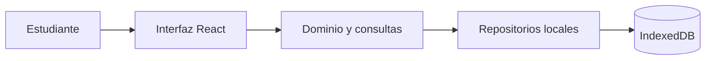

# Plan técnico de StudyFlow

Estado: propuesta técnica actualizada según la SPEC aprobada; pendiente de revisión y aprobación. No autoriza por sí sola el inicio de IMPLEMENTATION.

## 1. Arquitectura general

StudyFlow será una aplicación web cliente. React presenta las pantallas, TypeScript organiza los tipos y reglas, Vite construye y sirve el cliente, y la API nativa de IndexedDB conserva materias y actividades en el mismo perfil y origen del navegador. El MVP no requiere backend, API, base remota, autenticación ni sincronización.



Las operaciones de producto no dependen de una conexión de red. Los datos no se comparten entre perfiles, navegadores ni dispositivos (RF-01–RF-02; RNF-02).

## 2. Stack y decisiones técnicas

| Área | Decisión | Motivo ligado a la SPEC | Alternativa descartada |
| --- | --- | --- | --- |
| Interfaz y compilación | React + TypeScript + Vite | Stack aprobado; organiza la interfaz cliente y permite validar tipos y generar la aplicación web. | Framework de servidor/full-stack: no hay requisito de servidor. |
| Persistencia | IndexedDB nativo | Conserva datos estructurados entre usos en el navegador y permite transacciones locales (RF-01–RF-02, RNF-02). | `localStorage` y almacenamiento remoto; el primero no es transaccional para las operaciones relacionadas, el segundo contradice el alcance local. |
| Reglas de datos | Módulos TypeScript de dominio | Centralizan validación, comparación de fechas, estados y consultas usados por la interfaz y los repositorios. | Duplicar reglas en componentes. |
| Segmentación de texto | `Intl.Segmenter` con granularidad `grapheme` | Cuenta los grafemas exigidos para nombres y títulos (RF-04, RF-08; CA-02, CA-16). Está disponible en versiones actuales de los navegadores aprobados. | Longitud de cadena (`.length`) o conteo de puntos de código, que no equivale necesariamente a grafemas. |
| Orden de títulos | `Intl.Collator("es", { sensitivity: "accent" })` | Comparación lingüística española que ignora diferencias de mayúsculas y conserva diferencias de acentos (RF-22; CA-11). El ID desempata resultados iguales. | Orden por puntos de código o conversión a minúsculas seguida de comparación binaria. |
| API y backend | No se incorporan | Ningún requisito necesita servicio remoto; la persistencia aprobada es local. | Django REST Framework, PostgreSQL, REST y OpenAPI quedan fuera del diseño del MVP. |

No se propone añadir dependencias de producción para IndexedDB, segmentación, comparación alfabética o fechas. Las API de internacionalización nativas cubren los requisitos de grafemas y ordenación; su uso se verifica en navegadores compatibles según RNF-01. Referencias: [MDN `Intl.Segmenter`](https://developer.mozilla.org/en-US/docs/Web/JavaScript/Reference/Global_Objects/Intl/Segmenter) y [MDN `Intl.Collator`](https://developer.mozilla.org/en-US/docs/Web/JavaScript/Reference/Global_Objects/Intl/Collator).

## 3. Estructura de módulos

Estructura propuesta para implementación; este PLAN no crea archivos de código:

```text
studyflow/src/
├── app/                         # inicio y composición de la aplicación
├── features/
│   ├── subjects/                # alta y consulta de materias
│   └── activities/              # formularios, lista, estado, filtros y borrado
├── domain/
│   ├── subjects/                # validación y equivalencia de nombres
│   ├── activities/              # modelo y validación de actividades
│   ├── dates/                   # fecha gregoriana, fecha local y vencimientos
│   └── queries/                 # filtros y ordenación de listas
├── persistence/
│   ├── database/                # apertura y versión de IndexedDB
│   ├── subjects/                # repositorio local de materias
│   └── activities/              # repositorio local de actividades
└── shared/                      # presentación común de errores

tests/
├── unit/                        # validadores, fechas y consultas de dominio
├── integration/                 # repositorios y transacciones IndexedDB
└── component/                   # formularios y comportamiento visible
```

`features` coordina interacción y muestra mensajes; `domain` contiene reglas sin acceso a la interfaz ni a IndexedDB; `persistence` encapsula la base local. No se crearán módulos de cuenta, correo, autenticación, servidor o sincronización.

## 4. Modelo de datos local

La base IndexedDB propuesta se denomina `studyflow` y contiene dos almacenes:

### `subjects`

| Campo | Tipo | Regla |
| --- | --- | --- |
| `id` | UUID, clave primaria | Identificador técnico estable. |
| `name` | cadena | Único dato de negocio; se conserva tal como se ingresó. Hasta 100 grafemas Unicode. |
| `normalizedName` | cadena técnica | Clave calculada para detectar equivalencias; índice único. |

La validación cuenta los grafemas de la entrada original. Para obtener `normalizedName`, se recortan únicamente los extremos que cumplen Unicode `White_Space` y se aplica conversión Unicode a minúsculas sin depender del idioma configurado en el navegador. La comparación conserva acentos y espacios interiores. La clave normalizada no se presenta como dato de negocio. No se implementan operaciones de edición o eliminación de materias (RF-03–RF-06).

### `activities`

| Campo | Tipo | Regla |
| --- | --- | --- |
| `id` | UUID, clave primaria | Permite identificar registros aunque compartan título y desempatar ordenación. |
| `title` | cadena | Obligatorio; máximo 100 grafemas Unicode; no tiene restricción de unicidad. |
| `type` | enumeración | `tarea`, `trabajo` o `examen`. |
| `subjectId` | UUID | Referencia a una materia registrada. |
| `dueDate` | cadena de fecha ISO `YYYY-MM-DD` | Fecha calendario gregoriana, sin hora ni zona horaria. |
| `description` | cadena o `null` | Si falta, está vacía o solo contiene Unicode `White_Space`, se almacena como omitida (`null`). El texto con contenido se conserva sin recorte ni límite adicional. |
| `status` | enumeración | `pendiente` o `completada`; el alta asigna `pendiente`. |

Índices: `subjects.normalizedName` único; `activities.subjectId`, `activities.status` y `activities.dueDate` no únicos. No se crea índice único para títulos. El vencimiento no se persiste porque depende del día local de consulta.

## 5. Persistencia y validación

- Al iniciar, abrir IndexedDB y consultar materias y actividades para la interfaz. Al volver a usar la aplicación, leer los registros locales disponibles (RF-01–RF-02).
- Encapsular el acceso a la base en repositorios. Escribir cada operación en una transacción y considerar confirmado el resultado solo al recibir confirmación de su finalización.
- Crear y editar actividades solo con `subjectId` válido. Verificar la relación en la misma transacción de escritura para reducir el riesgo de referencias huérfanas.
- No borrar ni reemplazar la base al inicializarla, migrar su esquema o responder a un fallo. Mantener versión de esquema para cambios internos futuros; no se prevé importación de datos remotos.
- Validar antes de escribir. Los errores de validación impiden iniciar la escritura; en edición se conservan los datos previos (RF-04, RF-08–RF-10; CA-02, CA-04, CA-16).
- Para contar nombres y títulos, usar segmentación Unicode por grafemas y rechazar una longitud mayor que 100. No contar unidades UTF-16 ni puntos de código como sustituto.
- Definir el predicado de espacio en blanco mediante Unicode `White_Space`, no depender únicamente de `String.trim()`. Para la materia, recortar solo extremos al producir la clave de comparación, convertir a minúsculas de manera independiente del idioma del navegador y guardar el valor ingresado sin alterarlo; no retirar acentos ni cambiar espacios internos.
- En título, rechazar ausencia, cadena vacía o compuesta únicamente por espacios conforme al texto de RF-08; no añadir unicidad. Tipo y materia deben ser válidos.
- En descripción, convertir ausencia, cadena vacía o solo Unicode `White_Space` en valor omitido; si tiene contenido, conservar la cadena completa, sin recortarla ni imponer máximo (RF-07, RF-12; CA-03).
- Validar fechas por componentes de calendario gregoriano antes de persistir. Aplicar año bisiesto si es divisible por 4, excepto los años seculares no divisibles por 400. Rechazar componentes imposibles; no aceptar hora ni convertir la fecha de entrega a UTC (RF-10, RF-17; CA-04, CA-08).

La representación técnica ISO propuesta conserva el orden de año, mes y día para almacenamiento. La validación debe comprobar calendario antes de convertir o normalizar valores, porque algunos constructores de fecha normalizan días imposibles automáticamente.

## 6. Estados, fecha local, vencimientos, filtros y orden

### Estado

Las transiciones permitidas son `pendiente` ↔ `completada`. Alta asigna `pendiente`; cada cambio modifica el registro por ID y se conserva localmente. El estado no cambia la fecha de entrega (RF-14–RF-15; CA-07, CA-14).

### Fecha y clasificación

- Obtener «hoy» del año, mes y día locales del navegador en cada consulta; no usar una representación UTC como fecha local (RF-26; CA-12–CA-15).
- Manipular fechas como fechas de calendario, sin sumar milisegundos o asumir que cada día tiene una duración horaria fija. El límite superior inclusivo es hoy más tres días calendario.
- Para una actividad pendiente: fecha anterior a hoy = «Vencidas»; desde hoy hasta hoy+3 inclusive = «Próximas a vencer»; posterior a hoy+3 = «Posteriores a tres días».
- Las completadas quedan fuera de las tres categorías de vencimiento. Cambiar el día local recalcula la clasificación en la próxima consulta, sin modificar `dueDate`.
- No almacenar la clasificación derivada en IndexedDB.

### Filtros y orden

- Ofrecer filtro de vencimiento «Todos» (sin predicado de vencimiento), «Vencidas», «Próximas a vencer» y «Posteriores a tres días» (RF-21; CA-10, CA-17).
- Aplicar filtros activos por materia, estado y vencimiento con conjunción lógica (AND). «Todos» desactiva únicamente el filtro de vencimiento. Una actividad completada no coincide con ninguna categoría de vencimiento; combinada con un estado completado, el filtro de categoría devuelve lista vacía.
- Ordenar el conjunto filtrado por fecha ascendente, después con `Intl.Collator("es", { sensitivity: "accent" })`, y finalmente por ID estable ascendente si ambos criterios anteriores empatan (RF-22; CA-11).
- No paginar el listado durante el MVP (DA-03).

## 7. Manejo de errores

La interfaz distingue rechazo de validación de fallo de persistencia. Los mensajes no muestran detalles técnicos.

| Situación | Respuesta técnica y visible |
| --- | --- |
| Materia o actividad inválida | No iniciar la escritura; explicar el error de validación y comunicar que la operación no se guardó. En edición, mantener los datos anteriores sin cambios. |
| Nombre de materia equivalente | Rechazar el alta, informar que no se guardó y mantener el registro existente. La restricción única del índice complementa la validación previa. |
| Fallo de IndexedDB, cuota, apertura o transacción | Informar que la operación no pudo confirmarse o completarse; no mostrar éxito ni afirmar un estado que no se verificó. No sobrescribir ni eliminar intencionalmente datos existentes como respuesta al fallo. |
| Confirmación de borrado cancelada | No enviar operación de borrado; conservar la actividad. Una eliminación confirmada no tiene acción para deshacer (RF-13; CA-05–CA-06). |
| Lista sin coincidencias | Resultado de consulta vacío. La presentación concreta sigue abierta según DA-02. |

El diseño no especifica recuperación automática ante cuota agotada o almacenamiento corrupto (DA-01). No añade telemetría, servicios externos ni copias de seguridad.

## 8. Seguridad y límites operativos

- Mantener los datos académicos en IndexedDB del perfil/origen activo; no enviar los datos a un backend.
- Mostrar títulos y descripciones como texto, sin interpretarlos como HTML activo.
- No almacenar credenciales ni utilizar cookies de sesión, endpoints remotos, autenticación, autorización de usuario o CSRF de sesión: no existen cuentas ni servidor en el MVP.
- La persistencia del navegador no implica cifrado ni protección contra otras personas con acceso al mismo perfil. La SPEC no exige ni promete esas propiedades.
- La interfaz debe funcionar en versiones actuales de Chrome, Edge y Firefox de escritorio (RNF-01; CA-19).

## 9. Estrategia futura de pruebas

En esta fase no se ejecutan pruebas. Durante IMPLEMENTATION, crear primero pruebas de cada tarea y luego el código correspondiente. La ejecución final debe relacionar resultados con los CA y no declarar conforme lo que no se haya verificado.

1. **Dominio de materias:** cadena vacía/Unicode `White_Space`, hasta 100 y 101 grafemas, grafemas compuestos, espacios exteriores Unicode, mayúsculas, acentos y espacios interiores (RF-03–RF-04; CA-02).
2. **Dominio de actividades:** campos requeridos, 100/101 grafemas, título vacío/solo espacios, tipos permitidos, títulos repetidos, materia existente y descripción omitida/vacía/Unicode `White_Space` o larga con contenido conservado (RF-07–RF-12; CA-03–CA-06, CA-16).
3. **Calendario:** fechas gregorianas válidas e imposibles, años divisibles por 4, años seculares divisibles/no divisibles por 400, pasado, hoy y límites diarios; cambio de mes/año y actualización de fecha local sin mutar entrega almacenada (RF-10, RF-16–RF-17, RF-23–RF-26; CA-04, CA-08, CA-12–CA-15).
4. **Repositorios IndexedDB:** alta/consulta de materias, operaciones de actividad por ID, estado y descripción persistidos, reapertura de base, relación con materia, duplicados de título y errores de escritura (RF-01–RF-02, RF-11–RF-15, RF-27; CA-01, CA-05–CA-07, CA-18).
5. **Consultas:** cada filtro individual y combinado, «Todos», completadas fuera de categorías de vencimiento, fecha/título/ID como orden (RF-18–RF-26; CA-09–CA-17).
6. **Interfaz y compatibilidad:** mensajes distintos para validación y almacenamiento, edición inválida conserva los datos previos, borrado confirmado/cancelado y recorrido de uso en navegadores incluidos en RNF-01 (CA-04–CA-06, CA-18–CA-19).
7. **Aceptación:** ejecutar los recorridos aplicables de CA-01 a CA-19 y registrar evidencia; no definir visualización, accesibilidad ni recuperación para resolver DA-01/DA-02 por suposición.

La estrategia no incluye pruebas de servidor, API, autenticación, correo o sincronización porque esos componentes están fuera de la SPEC.

## 10. Matriz de trazabilidad

| Requisitos de SPEC | Decisión de diseño | Criterios de aceptación |
| --- | --- | --- |
| RF-01–RF-02 | Repositorios IndexedDB, transacciones locales y carga en usos posteriores. | CA-01, CA-07 |
| RF-03–RF-06 | Materias; límite por grafemas; comparación sin distinción de caja ni espacios Unicode exteriores; índice único; solo alta/consulta. | CA-02 |
| RF-07–RF-10 | Validadores de actividad, descripción omitida según Unicode `White_Space`, tipo permitido y calendario gregoriano. | CA-03–CA-04, CA-16 |
| RF-11–RF-13 | IDs independientes del título, edición/borrado por ID, confirmación antes de borrar y sin deshacer. | CA-05–CA-06 |
| RF-14–RF-15 | Estado local y transiciones en ambas direcciones; alta pendiente. | CA-07, CA-14 |
| RF-16–RF-17 | Fecha calendario sin hora y admisión de fechas pasadas. | CA-08, CA-15 |
| RF-18–RF-20 | Lista consultable y predicados por materia y estado. | CA-09, CA-17 |
| RF-21 | Cuatro opciones de vencimiento y filtros AND; completadas fuera de categorías. | CA-10, CA-17 |
| RF-22 | Fecha ascendente, colación española con acentos significativos y desempate por ID. | CA-11 |
| RF-23–RF-25 | Clasificación pendiente vencida/próxima/posterior; completadas fuera de categorías. | CA-10, CA-12–CA-14 |
| RF-26 | Día local consultado dinámicamente, sin mutar `dueDate`. | CA-12–CA-15 |
| RF-27 | Errores de almacenamiento separados de validación, sin confirmación no verificada ni borrado/reemplazo deliberado. | CA-18 |
| RNF-01 | Verificación en Chrome, Edge y Firefox actuales de escritorio. | CA-19 |
| RNF-02–RNF-03 | IndexedDB local, fecha calendario separada de fecha local de vencimientos. | CA-01, CA-08, CA-15 |

## 11. Alternativas descartadas

- Django REST Framework, PostgreSQL y API REST: no se requieren para datos locales y añadirían servidor/sincronización fuera de alcance.
- Cuentas, autenticación, sesiones, contraseñas, correo y recuperación: excluidos por la SPEC vigente.
- `localStorage`: descartado frente a IndexedDB para operaciones transaccionales con datos relacionados.
- Bibliotecas de persistencia/fechas: no se proponen, dado que IndexedDB e internacionalización están disponibles en el entorno de navegador aprobado.
- Paginación e idempotencia especial: no se incorporan conforme a decisiones aprobadas; los títulos repetidos se permiten.

## 12. Dudas no bloqueantes

Se mantienen sin resolver y no se convierten en decisiones técnicas o requisitos de producto:

- **DA-01:** recuperación manual ante cuota agotada o almacenamiento local corrupto. El plan define el mensaje de fallo y la no destrucción intencional, no un procedimiento de recuperación.
- **DA-02:** accesibilidad, estados vacíos, idioma de interfaz y formato visual de fecha. No se fijan patrones visuales adicionales.
- **DA-03:** volúmenes esperados y umbrales de rendimiento. El listado permanece sin paginación; no se establece un objetivo de carga.
